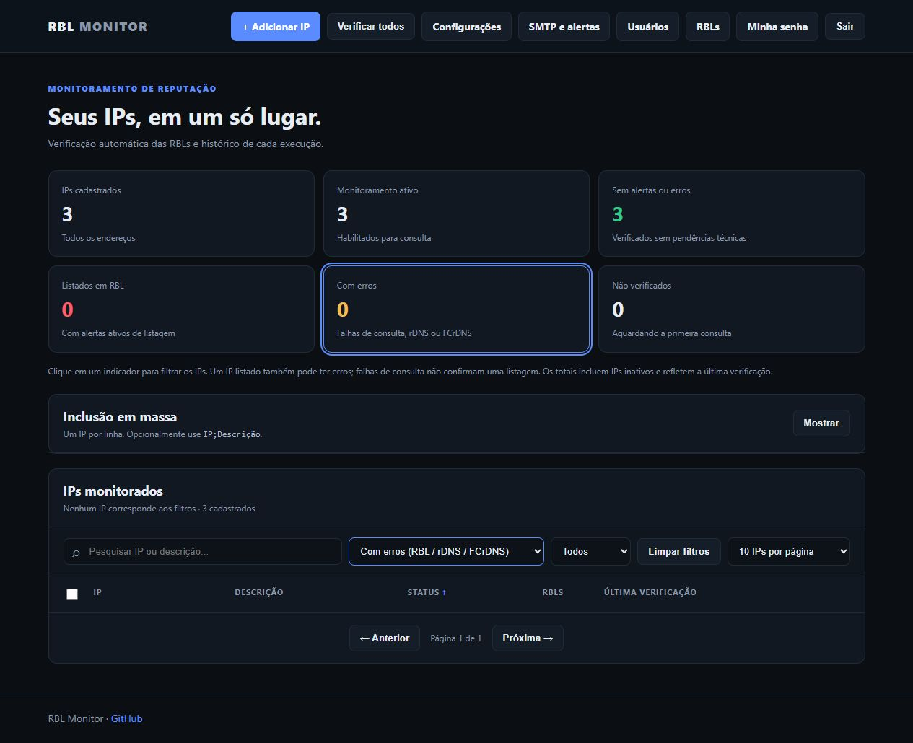
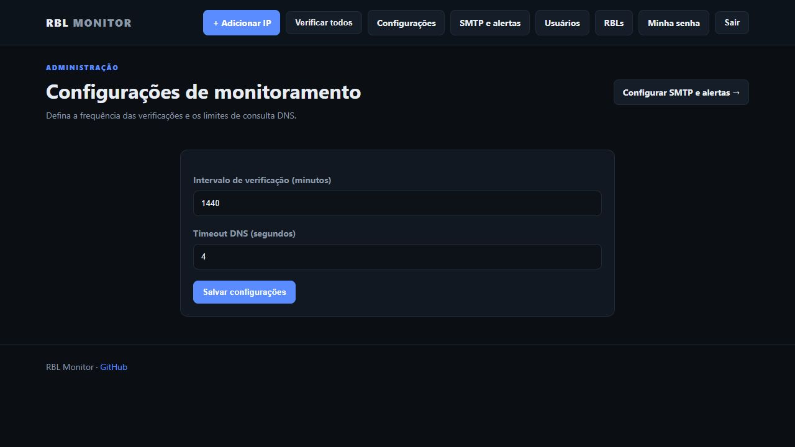
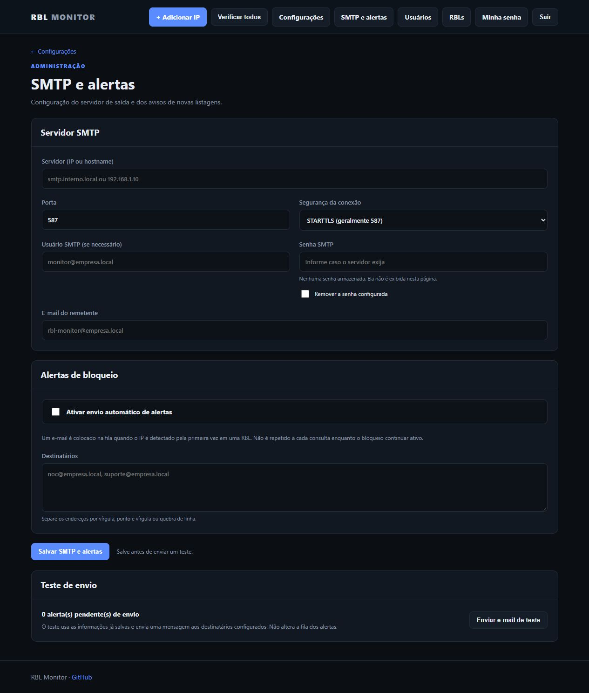

# RBL Monitor

Aplicação web interna (Flask + SQLite) para verificar endereços IPv4/IPv6 em listas DNSBL/RBL, acompanhar rDNS/FCrDNS, registrar histórico e notificar novos alertas por e-mail.

## Funcionalidades

- Dashboard com indicadores clicáveis, busca/filtros e paginação de 10, 20 ou 50 IPs. Ordem inicial: LISTED, ERRO, CLEAN e demais estados; ações em lote afetam os selecionados da página visível.
- Cadastro, edição e exclusão de IPs; verificação automática em intervalos configuráveis e execução manual.
- Consulta paralela de RBLs habilitadas, com classificação de `LISTED`, `CLEAN`, falhas de DNS, timeout e respostas não reconhecidas.
- rDNS (PTR) e FCrDNS (nome PTR resolvendo de volta para o IP original), com suporte a IPv4/IPv6 na validação de identidade.
- Detalhes por IP: resultados, respostas completas, tempos de execução e observações. Histórico e episódios ficam recolhidos e têm paginação independente de 15 eventos.
- Tentativa individual da RBL com erro naquele IP, sem repetir as demais RBLs e sem refazer rDNS/FCrDNS. Histórico preservado.
- Nova verificação solicitada por visitantes sem login na página de detalhes, com token CSRF e limites de frequência.
- Administração de listas RBL: habilitação, suporte IPv6, links de delisting, chave SpamRATS e Spamhaus DQS, com salvamento conjunto.
- Spamhaus ZEN e APEWS Level 2 desativadas por padrão; configure a chave DQS antes de habilitar ZEN. Erros de acesso não são considerados listagens.
- Gestão de alertas por IP/RBL: encerrar manualmente, ignorar, voltar a alertar; desativar uma RBL encerra os alertas operacionais associados, sem apagar o histórico.
- Configuração SMTP por painel (servidor, porta, STARTTLS/SSL/sem TLS, autenticação, remetente, destinatários) e envio de teste.
- Contas de usuário, administrador inicial, proteção CSRF, login e troca de senha.
- Datas na interface em `dd/mm/aaaa HH:mm:ss` no fuso `America/Sao_Paulo`; datas internas são mantidas em UTC.

**Observação:** um registro LISTED é uma resposta da RBL, não um veredito universal de spam. Respostas temporárias de DNS não são consideradas listagens confirmadas. Algumas RBLs exigem acesso pago, chave ou resolvedor DNS próprio.

## Capturas da interface

Painel com indicadores e paginação. Os três IPs cadastrados foram ocultados usando o filtro da interface; os dados no servidor foram preservados.



<details>
<summary>Configurações de monitoramento</summary>



</details>

<details>
<summary>SMTP e alertas — sem credenciais</summary>



</details>

## Arquitetura simples

- **Servidor:** Gunicorn (uma instância worker), porta TCP **8080**, sem NGINX.
- **Diretório único:** `/opt/rbl-monitor` contém código, templates, arquivos locais, `.venv`, `.env`, `data/monitor.db`, `backups` e o script de atualização.
- **systemd:** é necessário somente um link de registro do serviço em `/etc/systemd/system/`.
- **Persistência:** SQLite, sem MySQL/PostgreSQL ou Docker.
- **Requisitos:** Ubuntu/Debian com `systemd`, Python 3.10 ou superior com `venv`, Internet para dependências APT/PyPI, DNS funcional, acesso `sudo`.

## Começar

**Nova instalação (cancela ao encontrar instalação anterior):**

Baixe o ZIP do [release mais recente](https://github.com/lucianopm/rbl-monitor/releases/latest) ou use o comando abaixo. Requisitos e preparação do servidor em [INSTALACAO.md](INSTALACAO.md).

```bash
curl -fL https://github.com/lucianopm/rbl-monitor/releases/latest/download/rbl-monitor.zip -o rbl-monitor.zip
unzip rbl-monitor.zip
cd rbl-monitor
sudo bash install.sh
```

Acesse `http://IP_DO_SERVIDOR:8080/login`. O script exibe a senha inicial `admin` uma única vez.

Os próximos releases usam `rbl-monitor.zip`. No release v1.1.0, o anexo ainda tem o nome antigo; baixe-o e renomeie-o para `rbl-monitor.zip` antes de seguir os comandos, ou use o comando de compatibilidade em [INSTALACAO.md](INSTALACAO.md).

**Buscar a versão mais atual no GitHub para atualizar uma instalação existente:**

```bash
sudo bash /opt/rbl-monitor/update.sh --repo https://github.com/lucianopm/rbl-monitor.git --branch main
```

Use `update.sh` para atualizar. O instalador recusa instalações existentes para preservar banco, usuários e histórico.

Para escolher o canal: `sudo bash /opt/rbl-monitor/update.sh --main` (estável) ou `sudo bash /opt/rbl-monitor/update.sh --dev` (desenvolvimento). A escolha é salva somente após atualização bem-sucedida e usada nas próximas atualizações, inclusive automáticas. Voltar de dev para main exige conferir compatibilidade do banco; veja [ATUALIZACAO_GIT.md](ATUALIZACAO_GIT.md).

Para redefinir a senha administrativa com backup:

```bash
sudo /opt/rbl-monitor/.venv/bin/python /opt/rbl-monitor/reset-admin-password.py
```

## Documentação

| Documento | Conteúdo |
|---|---|
| [INSTALACAO.md](INSTALACAO.md) | Preparação do Linux, instalação limpa, chaves, verificação e erros comuns |
| [USO.md](USO.md) | Cadastro de IPs, RBLs, retry, status, SMTP, rDNS/FCrDNS e permissões |
| [ATUALIZACAO_GIT.md](ATUALIZACAO_GIT.md) | Busca da versão atual, configuração da origem, atualizações, backup e recuperação |
| [SEGURANCA.md](SEGURANCA.md) | Auditoria do pacote, arquivos sensíveis, acesso interno e cuidados operacionais |
| [TROUBLESHOOTING.md](TROUBLESHOOTING.md) | DNS, SMTP, SQLite, HTTPS, serviço e recuperação |
| [VALIDACAO.md](VALIDACAO.md) | Testes realizados e limitações desta entrega |

## Comandos essenciais

```bash
sudo systemctl status rbl-monitor --no-pager
sudo systemctl restart rbl-monitor
sudo journalctl -u rbl-monitor -n 100 --no-pager
curl -fsS http://127.0.0.1:8080/health
```

Este código é fornecido sem banco SQLite real, credenciais, `.env` ou chaves. A auditoria estática não substitui testes de implantação no seu servidor.
